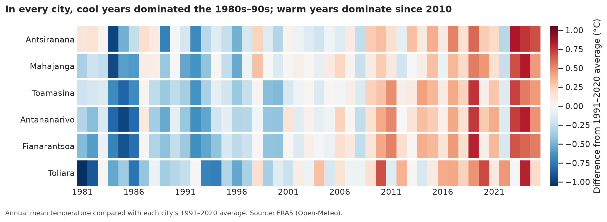
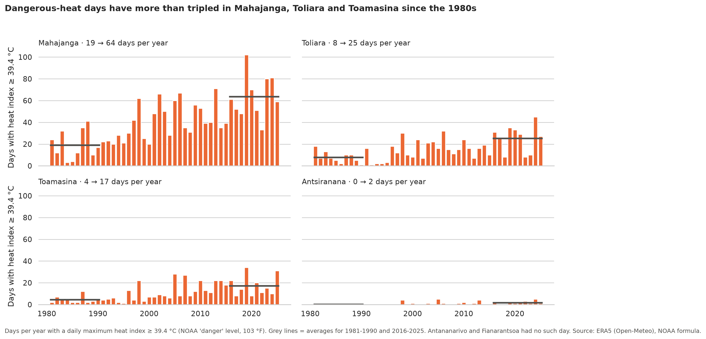
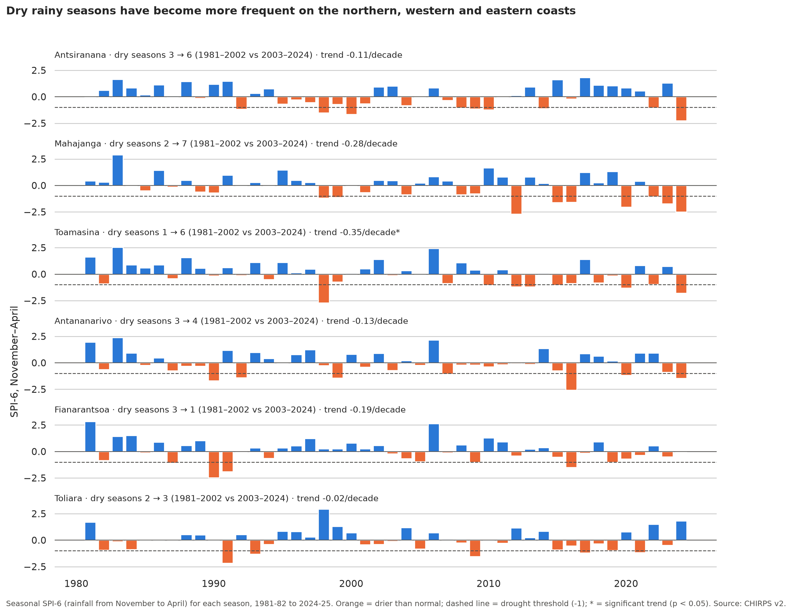

# Heather — Madagascar Climate Analysis (1981–2025)

> 🇫🇷 **Résumé.** Ce projet analyse 45 ans de données climatiques journalières (1981–2025) dans six villes de Madagascar pour mesurer l'évolution de trois risques qui touchent directement la population : des pluies peu fiables, la sécheresse et la chaleur dangereuse. Les six villes se sont réchauffées d'environ 1 °C. Les jours de chaleur dangereuse ont plus que triplé sur trois côtes, et les saisons des pluies sont devenues plus sèches au nord, à l'ouest et à l'est, alors que la date de début des pluies n'a pas changé. Mahajanga, sur la côte ouest, est la seule ville où deux risques augmentent en même temps.

## Summary
This project analyses 45 years of daily climate data (1981–2025) for six cities of Madagascar to measure how three climate risks that directly affect people have changed: unreliable rains, drought and dangerous heat.

- **All six cities have warmed by about 1 °C since 1981** (+0.18 to +0.26 °C per decade), a result confirmed by two independent datasets.
- **Dangerous heat is the fastest-growing risk:** days above the NOAA "danger" heat-index level have more than tripled on three coasts, reaching about two months per year in Mahajanga.
- **Rainy seasons have become drier on the northern, western and eastern coasts**, but not on the Highlands or in the South.
- **The start of the rainy season has not shifted**; in the South (Toliara), unreliable rains are a long-standing problem rather than a new one.
- **Mahajanga, on the west coast, is the hotspot**: it is the only city where two risks are rising together.

Tools: Python (pandas, NumPy, SciPy, pymannkendall, Matplotlib, seaborn), Jupyter, three public climate datasets accessed through their APIs.



## 1. Ask

### Business task
Use 45 years of daily climate data (1981–2025) to measure how the climate risks that most affect people's lives in Madagascar — unreliable rains, drought and dangerous heat — have evolved, and identify the regions and communities most exposed.

**Main question:** Is Madagascar's climate becoming harder to live with — less reliable for farmers, drier in the South and more dangerous in the heat — and where is the risk growing fastest?

### Key questions
1. **Rain reliability (food)** — Does the rainy season start later, vary more from year to year, or have more "false starts" (first rains followed by a long dry spell that ruins the sowing)?
2. **Drought (water)** — Are droughts becoming more frequent, longer or more severe, especially in the semi-arid South (Toliara)?
3. **Dangerous heat (health)** — How many days per year exceed heat-index danger thresholds, and is this number increasing?
4. **Inequality between regions** — Which regions face the fastest-growing risks, and are the most exposed regions the same for all three risks?

### Scope
| | |
|---|---|
| **Cities** | Antananarivo, Fianarantsoa, Toamasina, Mahajanga, Antsiranana, Toliara |
| **Period** | 1 January 1981 – 31 December 2025, daily values |
| **Variables** | Mean, maximum and minimum temperature at 2 m (°C), relative humidity (%), heat index (°C), precipitation (mm/day) |
| **Sources** | ERA5 for temperature, humidity and heat index; CHIRPS for rainfall; NASA POWER as a cross-check |

**Out of scope:** this project measures climate *hazards*, not their impacts. Crop yields, food insecurity and health outcomes would require additional data and are planned as a follow-up project (starting with malaria).

### Stakeholders
| Stakeholder | How the results could help |
|---|---|
| Farmers and agricultural extension services | Adapt sowing dates and choose crop varieties suited to a less reliable rainy season |
| Environmental and food-security organisations | Target drought preparedness and resilience programmes where the risk grows fastest |
| Public-health authorities and municipalities | Prepare heat-wave alerts and protect the most vulnerable people in cities |
| Citizens and local communities | Understand, with clear figures, how their region's climate has changed in their lifetime |

## 2. Prepare

### Data sources
| Source | Variables used | Resolution | Retrieved with |
|---|---|---|---|
| [ERA5](https://www.ecmwf.int/en/forecasts/dataset/ecmwf-reanalysis-v5) reanalysis (ECMWF), through the [Open-Meteo](https://open-meteo.com/) archive API (`models=era5`) | Daily mean, max and min temperature; hourly temperature and humidity (for the heat index) | 0.25° grid cell (about 25 km) | [`src/fetch_era5.py`](src/fetch_era5.py), [`src/fetch_era5_heat.py`](src/fetch_era5_heat.py) |
| [CHIRPS v2](https://www.chc.ucsb.edu/data/chirps) (Climate Hazards Center, UC Santa Barbara), through the [ClimateSERV](https://climateserv.servirglobal.net/) API | Daily rainfall | 0.05° grid cell (about 5 km) | [`src/fetch_chirps.py`](src/fetch_chirps.py) |
| [NASA POWER](https://power.larc.nasa.gov/) (MERRA-2 reanalysis), Daily Point API | Temperature, humidity and rainfall, **used only as a cross-check** | 0.5° × 0.625° grid cell (about 55 × 65 km) | [`src/fetch_data.py`](src/fetch_data.py) |

Data were downloaded between 9 and 13 November 2026.

**Why three sources?** NASA POWER was first used for every variable. Two checks showed its limits:
- **Rainfall:** compared with published long-term normals, NASA POWER puts far too much rain on the Highlands and far too little on the east coast. Rainfall was replaced by CHIRPS, a reference dataset for drought monitoring in Africa that blends satellite imagery with rain-gauge records.
- **Temperature:** NASA POWER showed an unusually fast warming in Fianarantsoa that diverged from nearby Antananarivo after 2014. Temperature trends were cross-checked with ERA5, which agrees with NASA POWER in four cities but not in Fianarantsoa and Toliara. ERA5 (finer grid, no such divergence) became the main temperature source.

Each variable is therefore taken from the source that passed validation.

### Data collected
| City | Climate zone | Latitude | Longitude |
|---|---|---|---|
| Antananarivo | Central Highlands | -18.91 | 47.52 |
| Fianarantsoa | Southern Highlands | -21.45 | 47.09 |
| Toamasina | East coast | -18.15 | 49.40 |
| Mahajanga | West coast | -15.72 | 46.32 |
| Antsiranana | Far north | -12.28 | 49.29 |
| Toliara | Semi-arid south | -23.35 | 43.67 |

| Variable | Description | Unit | Source |
|---|---|---|---|
| `tmean_era5`, `tmax_era5`, `tmin_era5` | Daily mean, maximum and minimum air temperature at 2 m (**used for the analysis**) | °C | ERA5 |
| `rh_mean_era5` | Daily mean relative humidity at 2 m | % | ERA5 |
| `hi_max_era5` | Daily maximum heat index, computed hour by hour with the NOAA formula | °C | ERA5 |
| `rain_chirps` | Daily rainfall (**used for the analysis**) | mm/day | CHIRPS |
| `T2M`, `T2M_MAX`, `T2M_MIN`, `RH2M`, `PRECTOTCORR` | Temperature, humidity and rainfall (cross-check only) | °C, %, mm/day | NASA POWER |

- **Period:** 1 January 1981 – 31 December 2025, one value per day
- **Volume:** 16,436 days × 6 cities = 98,616 rows per source, stored as one CSV per city in `data/raw/` (NASA POWER), `data/raw/chirps/`, `data/raw/era5/` and `data/raw/era5_heat/`

### Rainfall validation
Mean annual rainfall over 1981–2025, compared with published long-term normals (mostly weather-station records, over different periods: use for order of magnitude only).

| City | NASA POWER | CHIRPS | Published normal | NASA POWER error | CHIRPS error |
|---|---|---|---|---|---|
| Toamasina | 1,926 mm | 3,271 mm | 3,368 mm | -43 % | **-3 %** |
| Antananarivo | 2,371 mm | 1,322 mm | 1,365 mm | +74 % | **-3 %** |
| Mahajanga | 1,417 mm | 1,470 mm | 1,476 mm | -4 % | **0 %** |
| Fianarantsoa | 2,038 mm | 1,151 mm | 1,085 mm | +88 % | **+6 %** |
| Toliara | 550 mm | 312 mm | about 360 mm (semi-arid south-west) | +53 % | **-13 %** |
| Antsiranana | 1,102 mm | 1,156 mm | 940 mm | +17 % | +23 % |

CHIRPS stays within about 15 % of the normals for five cities out of six, while NASA POWER is off by more than 40 % in four of them.

### Temperature cross-check
Trend of the annual mean temperature, Sen's slope in °C per decade (all significant, p < 0.05).

| City | NASA POWER | ERA5 |
|---|---|---|
| Antsiranana | +0.25 | +0.18 |
| Mahajanga | +0.20 | +0.20 |
| Toamasina | +0.22 | +0.22 |
| Antananarivo | +0.25 | +0.26 |
| Fianarantsoa | **+0.45** | +0.26 |
| Toliara | **+0.11** | +0.25 |

Both sources agree that every city has warmed; they disagree on the size of the trend in Fianarantsoa and Toliara.

### Data quality (ROCCC)
| Criterion | Assessment |
|---|---|
| **Reliable** | All sources come from recognised scientific institutions (ECMWF, UC Santa Barbara Climate Hazards Center, NASA) and are widely used in research, but they are gridded estimates, not weather-station records. Rainfall was checked against published normals and temperature against a second dataset |
| **Original** | Downloaded directly from the official APIs, with no intermediary dataset |
| **Comprehensive** | 45 years of daily data for 6 cities covering the main climate zones; no missing values and no duplicate dates in any source |
| **Current** | Covers the period up to 31 December 2025 |
| **Cited** | See *Sources & acknowledgements* |

### Known limitations of the data
- **Grid cells, not stations:** each value is an average over a grid cell. Local effects, such as the extra heat of cities, are smoothed out.
- **CHIRPS daily values are approximations:** CHIRPS is built on 5-day totals that are then split into days. Day-by-day indicators (dry spells, start of the rainy season) should be read as indicative; seasonal totals are more robust.

## 3. Process

Cleaning is done in [`notebooks/01_cleaning.ipynb`](notebooks/01_cleaning.ipynb) with Python (pandas). The output is `data/processed/madagascar_climate_daily.csv`: 98,616 rows × 18 columns, one row per city per day.

### Cleaning log
| Step | Operation | Result |
|---|---|---|
| 1 | Combined the 6 NASA POWER city files and added each city's climate zone | 98,616 rows (16,436 per city); every city mapped to a zone |
| 1b | Merged daily CHIRPS rainfall on city and date (one-to-one) | 0 days without a value |
| 1c | Merged daily ERA5 temperatures | 0 days without a value |
| 1d | Merged ERA5 daily humidity and daily maximum heat index (computed from hourly data, 24 hours checked for every day) | 0 days without a value |
| 2 | Converted `date` from text (`YYYYMMDD`) to a date type | Dates valid; all measurements stored as numbers |
| 3 | Replaced the missing-value codes (`-999` NASA POWER, `-9999` CHIRPS) with `NaN` | 0 missing values found |
| 4 | Consistency checks: duplicates, missing days, min ≤ mean ≤ max temperature (both sources), rainfall ≥ 0, humidity 0–100 %, plausible temperature and heat-index ranges | 0 rows failing; no rows removed or modified |
| 5 | Investigated extreme values | Hottest day: 39.8 °C (Toliara, 11 Jan 2025). Coldest night: 3.0 °C (Fianarantsoa, 30 Jun 2009). Wettest day in CHIRPS: 434 mm (Toamasina, 7 Apr 1992). The NASA POWER rainfall record (244 mm, Antananarivo, 12 Apr 2020) is not confirmed by CHIRPS (see *Limitations*) |
| 6 | Added `year`, `month`, `season` (rainy: Nov–Apr, dry: May–Oct) and `hydro_year` (1 July – 30 June) | Hydrological years 1980 and 2025 are incomplete and are excluded from rainy-season analyses |
| 7 | Validated mean annual rainfall of both sources against published normals | CHIRPS retained for all rainfall analyses |
| 8 | Reordered columns, sorted by city and date, saved the clean file | 98,616 rows × 18 columns |

## 4. Analyze

The analysis is in [`notebooks/02_analysis.ipynb`](notebooks/02_analysis.ipynb). Trends use Sen's slope with the Mann-Kendall test (Hamed-Rao correction for autocorrelation where it can be computed); a trend is called significant when p < 0.05.

| Question | Method | Answer |
|---|---|---|
| **Background warming** | Annual mean temperature, ERA5, cross-checked with NASA POWER | All six cities warmed by +0.18 to +0.26 °C per decade (about +1 °C since 1981). Daytime maximums rise faster than night-time minimums |
| **1. Rain reliability** | Onset of the rainy season (first 20 mm in 3 days not followed by 10 dry days within 30 days) and false starts, CHIRPS | No significant change in any city; false starts slightly decreased. In Toliara, 21 of 44 seasons never reach a reliable onset — a permanent, not a new, problem |
| **2. Drought** | Seasonal SPI-6 (November–April rainfall, gamma distribution fitted on 1991–2020) and SPI-3 drought months, CHIRPS | Drier rainy seasons on the coasts: dry seasons 2 → 7 in Mahajanga, 1 → 6 in Toamasina (significant trend), 3 → 6 in Antsiranana between 1981–2002 and 2003–2024. No trend on the Highlands or in Toliara |
| **3. Dangerous heat** | Days per year with a daily maximum heat index ≥ 39.4 °C (NOAA "danger" level), computed hourly from ERA5 | More than tripled between 1981–1990 and 2016–2025: Mahajanga 19 → 64, Toliara 8 → 25, Toamasina 4 → 17 days per year (all p < 0.001). No such day on the Highlands |
| **4. Regions** | Comparison of the three risks city by city | The most exposed regions differ by risk. **Mahajanga** is the only city where two risks rise together (heat and drought). The Highlands warm as fast as the coasts but are protected from dangerous heat by altitude |





## 5. Share

All charts are exported to [`figures/`](figures/):

| Figure | Message |
|---|---|
| [`01_rainfall_normals.png`](figures/01_rainfall_normals.png) | The east coast gets rain all year; everywhere else, it falls between November and April |
| [`02_temperature_normals.png`](figures/02_temperature_normals.png) | The Highlands are about 6 to 10 °C cooler than the coasts all year round |
| [`03_warming_stripes.png`](figures/03_warming_stripes.png) | In every city, cool years dominated the 1980s–90s; warm years dominate since 2010 |
| [`04_rainy_season_onset.png`](figures/04_rainy_season_onset.png) | Since 1981, the rainy season has not started significantly later in any city |
| [`05_drought_spi.png`](figures/05_drought_spi.png) | Dry rainy seasons have become more frequent on the northern, western and eastern coasts |
| [`06_dangerous_heat_days.png`](figures/06_dangerous_heat_days.png) | Dangerous-heat days have more than tripled in Mahajanga, Toliara and Toamasina since the 1980s |

## 6. Act
_To be written in phase 6._

## Repository structure
```
heather/
├── data/
│   ├── raw/              # NASA POWER files, one per city (never modified)
│   │   ├── chirps/       # CHIRPS daily rainfall
│   │   ├── era5/         # ERA5 daily temperatures
│   │   └── era5_heat/    # ERA5 daily humidity and heat index
│   └── processed/        # clean dataset produced by 01_cleaning.ipynb
├── notebooks/
│   ├── 01_cleaning.ipynb
│   └── 02_analysis.ipynb
├── src/
│   ├── fetch_data.py       # NASA POWER
│   ├── fetch_chirps.py     # CHIRPS rainfall through ClimateSERV
│   ├── fetch_era5.py       # ERA5 daily temperatures through Open-Meteo
│   └── fetch_era5_heat.py  # ERA5 hourly temperature and humidity -> daily heat index
├── figures/              # exported charts
├── requirements.txt
└── README.md
```

## How to reproduce
```bash
git clone https://github.com/<your-username>/heather.git
cd heather
python3 -m venv .venv
source .venv/bin/activate          # Windows: .venv\Scripts\activate
pip install -r requirements.txt

python src/fetch_data.py           # NASA POWER: a few seconds per city
python src/fetch_chirps.py         # CHIRPS: a few minutes per city
python src/fetch_era5.py           # ERA5 daily temperatures
python src/fetch_era5_heat.py      # ERA5 hourly data: the longest download (rate limits)
```
Then run `notebooks/01_cleaning.ipynb` and `notebooks/02_analysis.ipynb` in order. The download scripts skip cities that are already saved, so they can be restarted safely.

## Limitations
- **Gridded estimates, not station records:** values describe grid cells of 5 to 25 km, not a precise point in a city.
- **Six cities cannot represent the whole island:** the severe 2020–21 drought of the far south (Androy, Anosy) does not appear in Toliara, where that season was wetter than normal.
- **The size of the warming is uncertain in two cities:** NASA POWER and ERA5 disagree for Fianarantsoa (+0.45 vs +0.26 °C per decade) and Toliara (+0.11 vs +0.25); only the direction of the trend is certain there.
- **Heat index:** computed for shade and light wind; full sunshine and urban heat make conditions worse than the figures show.
- **Rainy-season onset:** the rule comes from studies of wetter climates and is demanding for semi-arid Toliara; daily CHIRPS values are approximate.
- **Multiple tests:** with six cities, one p-value below 0.05 can occur by chance; conclusions rely on consistent results across cities, indicators and sources.
- **The NASA POWER rainfall record is probably a model artefact.** NASA POWER shows a six-day wet episode in Antananarivo (about 680 mm from 11 to 16 April 2020, including 244 mm on 12 April). CHIRPS records no rain at all on the same days, and no matching report was found.
- **Rainfall validation is approximate:** the published normals cover other periods (e.g. 1961–1990) and some come from secondary compilations.

## Sources & acknowledgements
- Hersbach, H. et al. (2020). The ERA5 global reanalysis. *Quarterly Journal of the Royal Meteorological Society*, 146, 1999–2049. https://doi.org/10.1002/qj.3803
- ERA5 data accessed through the [Open-Meteo](https://open-meteo.com/) historical weather API (weather data by Open-Meteo.com).
- Funk, C. et al. (2015). The climate hazards infrared precipitation with stations — a new environmental record for monitoring extremes. *Scientific Data*, 2, 150066. https://doi.org/10.1038/sdata.2015.66
- CHIRPS data were accessed through ClimateSERV (NASA / SERVIR).
- These data were obtained from the NASA Langley Research Center (LaRC) POWER Project funded through the NASA Earth Science/Applied Science Program.
- Heat index: Rothfusz, L. P. (1990). *The heat index "equation"*. NWS Southern Region Technical Attachment SR 90-23, with the adjustments used by the US National Weather Service.
- Published rainfall normals: NOAA climate normals 1961–1990 (Toamasina, Mahajanga) and public climate summaries for the other cities.

## Author
**Nirina Helena** — backend developer and junior data analyst, Antananarivo, Madagascar.